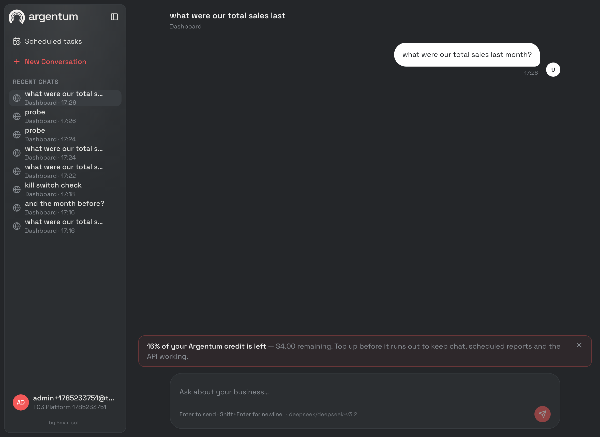
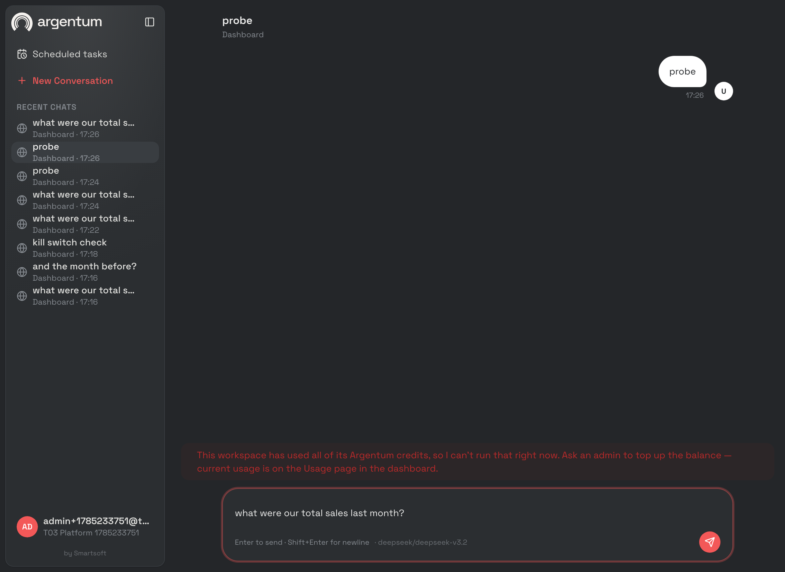

# Credit enforcement — T-03 record

Ticket: [`../plan/01-tickets.md`](../plan/01-tickets.md) `T-03`. Finding closed:
`B-1` — *"`UsageService.append` decrements the balance and ignores the result.
Nothing checks it. A tenant on platform LLM keys can spend without limit."*

Landed 2026-07-28. Last item of phase 1b; `T-A1` is now unblocked.

> **Since RIZ-79 (2026-10-12) the grant is written at signup and defaults to
> $0.50, not $25.** §1–§5 below are T-03's record as it landed and still say
> "$25" and "lazy"; §6 is what changed and why. The lazy path in §1 still
> exists — it is now the fallback for companies signup did not credit.
>
> **Since RIZ-83 (2026-10-13) a workspace can top up** by bank transfer with
> proof of payment, approved by an operator. §5's "there is no way to top up"
> and "no invalidation on write" are history; §7 is the top-up path.

---

## 1. What the ticket did not say, and had to be decided

**Nothing in Argentum has ever credited a company.** `company_credits` rows are
created by exactly one writer — `CreditsRepo.Decrement`, which upserts
`balance = balance - cost` and therefore mints rows with a **negative**
balance. `monthly_grant_micro_usd` defaults to 0 and no code path has ever set
it. Signup does not touch the table.

So on the day "balance ≤ 0 means refuse" is switched on:

- every tenant that has ever run a turn is below zero, and
- every tenant that has not has no row at all.

Implementing the ticket verbatim is a **global outage**, not a spend ceiling.
Before this run the local control DB had zero rows in `company_credits` and
production would look the same for any tenant that had not been metered.

Two further things fall out of the same gap. A grant is the only possible
denominator for the ticket's own `BudgetWarning` (*"<20% remaining"* — of
what?). And `GET /usage/credits` already renders `monthly_grant_micro_usd` in
the dashboard's overview tab as "of $X monthly grant", against a column that
was always 0.

**Decision: T-03 ships the grant.** `CheckBudget` provisions
`CREDITS_DEFAULT_GRANT_USD` (default `$25`) the first time it sees a company
with no grant, which also forgives pre-enforcement usage exactly once.

**Why in Go and not in a migration.** A backfill would freeze the number into
an applied migration, and an operator changing the env var would then have two
sources of truth that disagree — with the SQL one winning for every company
that existed on the day it ran. It also means this ticket claims no migration
number, after three consecutive tickets found their reserved number already
spent.

The grant is **not** a monthly refresh. The column is named `monthly_grant`
and nothing refills it; a recurring grant needs a period marker the table does
not have, and inventing one here would be billing design smuggled into an
enforcement ticket. What ships is a one-time starting balance.

## 2. The shape

`UsageService.CheckBudget(ctx, companyID) (BudgetState, error)` in
[`internal/app/credits.go`](../../apps/backend/internal/app/credits.go).
`BudgetState` is a struct rather than the bare enum the ticket sketched,
because the dashboard banner has to say how much is left and a second read to
find out would defeat the cache the check exists behind.

Order of resolution, and why it is that order:

1. **Kill switch and empty tenant** → `BudgetOK`. `CreditPolicy.Enforce` lives
   inside the checker, not at each wiring site, so `T-A1` cannot get a
   different answer by wiring itself differently.
2. **Cache hit** → return it. 60s TTL in Redis, keyed `credits:budget:<id>`.
3. **Own primary LLM key** → `BudgetOK`, `BYOLLM: true`, and the balance is
   never read. Consulting a number we never decrement for them would refuse a
   turn on a figure that has no meaning for that company.
4. **Balance** → provision the grant if there is none, then
   `≤ 0 → BudgetExhausted`, `< WarnPct% → BudgetWarning`, else `BudgetOK`.

### Decisions worth carrying forward

- **The check runs before the thread is resolved, not just before the enqueue.**
  A refusal that happened after `ResolveForPhone` / `CreateDashboardThread`
  would leave a thread and an orphan user message per attempt — a tenant at
  zero credits accumulating debris in proportion to how often they retry.
  Verified live: the refused turn added 0 threads and 0 messages.

- **"Has a primary row" was narrowed to "has a primary row carrying a key".**
  The ticket says skip the check when `company_llm_credentials` has a primary
  row. But `llmtenant.Resolver.merge` only swaps the API key when
  `APIKeyEncrypted` is non-empty — a row that overrides only the model or the
  base URL still spends the platform key. Read literally, the ticket lets any
  tenant opt out of billing by pinning a model name. Both halves are pinned in
  the tests and were proven live by dropping the key from a row and watching
  the same company flip from 202 to 402.

- **A repository failure fails open.** A credits lookup that errors returns
  `BudgetOK` with a `Warn`, matching the house rule for optional subsystems.
  Failing closed would turn a billing check into a product outage, and the
  control DB being unreachable already fails the turn one step later for its
  own reasons.

- **A second integration point was needed, for the same reason `T-05` needed
  one.** A cron tick never passes through `ChatEnqueuer` —
  `ScheduledTaskService.HandleFire` enqueues directly. An unattended schedule
  on an exhausted tenant is precisely the unbounded spend the ticket exists to
  stop, because nobody is watching it to notice. The check sits after
  `AppendRun` and before `AppendUserMessage`: the refusal is visible in the
  task's run history (a schedule that silently stops firing is
  indistinguishable from one that broke) and no prompt is appended that
  nothing will answer.

- **One refusal sentence, not four.** `app.CreditsExhaustedMessage` is shared
  by the 402 body, the WhatsApp reply, the Discord reply and the Lark reply. A
  WhatsApp user and a dashboard user hitting the same wall should be told the
  same thing, and per-channel wordings drift.

- **The chat channels answer 200, not 500.** WhatsApp and Lark retry a
  non-2xx, and retrying a turn the tenant cannot pay for delivers the same
  sentence several times. The refusal is spoken, then the webhook acknowledges.

- **The API process grew a Lark client.** Every Lark reply until now was
  written by the worker after the agent ran; a refusal happens before there is
  anything to enqueue, so the only process that can speak it is the API.
  `LarkWebhookHandler.WithReplier` is nil when Lark is disabled.

- **402, not 403 or 400.** The request was well-formed and the caller can fix
  it, which is what Payment Required means. `T-A1`'s error envelope reuses the
  status for the same condition.

### One frontend defect the gate caught

The warning banner did not render on the send that produces it. `/chat` and
`/chat/$threadId` are **two routes rendering the same component**, so the send
that returns a warning also navigates — unmounting one route and mounting the
other, resetting every `useState` in the file. The first send of a session is
exactly the case that loses its banner, and it is the case a near-empty
account is most likely to be in.

The warning now lives in the TanStack Query cache, which sits above the
router. Found only because the screenshot came back without a banner the API
had demonstrably returned.

## 3. Gate

### Static

```
$ go build ./... && go vet ./...
# clean

$ golangci-lint run
0 issues.

$ go test ./... -race
ok  github.com/fauzanebd/argentum/cmd/api
ok  github.com/fauzanebd/argentum/internal/app
ok  github.com/fauzanebd/argentum/internal/agentbudget
… 0 FAIL
```

New tests: `internal/app/credits_test.go` (verdict table incl. the
exactly-at-threshold boundary, one-time provisioning, the four BYO cases, five
fail-open paths, cache behaviour, `Normalize`, `remainingPct` clamping),
`internal/app/chat_enqueuer_budget_test.go`, `internal/app/scheduled_budget_test.go`.

The enqueuer and scheduled-fire tests build their subject with a **nil**
thread service and a **nil** enqueuer deliberately. That is the assertion: if
the gate ever stops short-circuiting, the next line dereferences a nil and the
test fails loudly, instead of passing quietly while a thread, a user message
and a queued agent turn are created for a tenant who cannot pay for them.

```
$ pnpm --filter dashboard build   # tsc -b && vite build → clean
$ pnpm --filter dashboard lint    # 0 errors, 6 pre-existing warnings
```

### Against a live API and a real Postgres

`cmd/api` against the local `argentum_postgres` (schema v23) and
`argentum_redis`, `CREDITS_ENFORCEMENT_ENABLED=true`,
`CREDITS_DEFAULT_GRANT_USD=25`, `CREDITS_WARNING_THRESHOLD_PCT=20`.

**Company A — platform keys.**

```
1. first send, no credits row has ever existed
   POST /api/chat                       -> HTTP 202
   company_credits                      -> balance 25000000, grant 25000000   (provisioned)

2. balance set to 0
   POST /api/chat                       -> HTTP 402
   {"error":"This workspace has used all of its Argentum credits, so I can't
     run that right now. Ask an admin to top up the balance — current usage is
     on the Usage page in the dashboard."}
   usage_events  0 -> 0
   threads       1 -> 1
   messages      1 -> 1

3. balance set to 4000000 (16% of the grant)
   POST /api/chat                       -> HTTP 202
   "budget_warning": {"verdict":"warning","balance_micro_usd":4000000,
                      "grant_micro_usd":25000000,"remaining_pct":16,
                      "byo_llm":false}
```

Step 2 is the ticket's gate verbatim: **402, and zero new `usage_events`
rows** — plus zero new threads and zero new messages, which the ticket did not
ask for and which the "check before resolving the thread" decision is what
buys.

**Company B — its own primary key, $50 overdrawn.**

```
4. primary row with api_key_encrypted set
   POST /api/chat                       -> HTTP 202     (never blocked)

5. same row, api_key_encrypted = NULL, same balance
   POST /api/chat                       -> HTTP 402
```

Step 5 is the narrowing in §2 shown against a live server: a model-only
override does not buy an exemption.

**Kill switch.**

```
6. CREDITS_ENFORCEMENT_ENABLED=false, company A at zero balance
   POST /api/chat                       -> HTTP 202
   company_credits                      -> unchanged (0 / 25000000)
```

### In the browser

Driven with headless Chrome over the DevTools protocol — the same method
[`report-branding.md`](report-branding.md) used, and for the same reason.

| The warning, on a send that also created the thread | The refusal, as the user reads it |
| --- | --- |
|  |  |

The banner reads *"16% of your Argentum credit is left — $4.00 remaining"* and
is the first send of that session, so it also demonstrates the route-remount
fix. Clicking its dismiss control removes it (`[role="status"]` → `NO BANNER`
in the DOM readout after the click). The refusal keeps the typed message in
the composer, so a user who tops up does not have to retype it.

## 4. Acceptance criteria, quoted back

- [x] *Tenant at zero balance gets 402 with an actionable message, no LLM call
      made* — step 2 above; zero `usage_events`, and the refusal names the fix
      and where to look.
- [x] *Tenant with own LLM credentials is never blocked* — step 4, at $50
      overdrawn.
- [x] *Warning banner appears below the threshold* — step 3 and the screenshot.
- [x] *Kill switch restores today's behaviour* — step 6.

## 5. Limits, stated

- **The 60s cache window cuts both ways.** A tenant can overspend by up to one
  TTL of turns after crossing zero, and a tenant whose balance was just topped
  up stays refused for up to a minute. There is no invalidation on write
  because there is no write path yet — see the next item.

- **There is no way to top up.** No endpoint, no admin UI, no billing
  integration. The only way to add credit today is SQL against
  `company_credits`, which is what this gate did. The refusal message tells a
  user to "ask an admin to top up the balance" and the admin's only tool is a
  database client. That is a real product gap, not an oversight of this
  ticket, and it should be a Sprint 2 item alongside whatever `T-13`'s keys
  end up billing.

- **The grant never refreshes.** `monthly_grant_micro_usd` is a starting
  balance here despite its name. A tenant who spends $25 is refused until
  someone intervenes.

- **`RecordLLM` still decrements past zero.** Enforcement is at the gate, not
  in the ledger: a turn that was allowed at 1¢ remaining and then cost 50¢
  drives the balance negative, and the *next* turn is refused. Bounding a turn
  mid-flight is `T-16`'s budget, not this one — the two are complementary and
  neither is a spend cap on a single expensive question.

- **No test covers the Redis implementation of `BudgetCache`**, only the
  in-memory fake and the live run. `RedisBudgetCache` is 30 lines whose only
  logic is "degrade to a miss", exercised end-to-end above.

- **The metering-vs-enforcement split is now two reads of the same table per
  turn** in the worst case (the check, then `Decrement`). The check is cached;
  the decrement is not, and does not need to be.

---

## 6. RIZ-79 — the grant moves to signup, and becomes $0.50 (2026-10-12)

Ticket: [`RIZ-79`](https://linear.app/rizkal-uhuy/issue/RIZ-79/new-users-get-dollar050-free-credit-on-first-sign-up).
The owner asked for every new signup to get exactly $0.50 of free credit. The
audit found most of that already built (§1–§5): what was missing was the
*when*, the *amount*, the label, and anything stopping a script from signing
up a thousand times.

### What changed

- **Signup writes the grant.** `AuthService.Signup` calls
  `UsageService.GrantSignupCredit` once the admin user exists — not after the
  company, because a signup that fails on the user insert leaves an orphan
  nobody can log into, and crediting it only makes it look like a tenant. The
  write is `CreditsRepository.InsertIfAbsent`: `INSERT … ON CONFLICT
  (company_id) DO NOTHING`. It cannot top a company up, forgive a debt, or run
  twice to any effect. It ignores the kill switch (the switch governs refusal,
  not bookkeeping) and writes nothing at a grant of 0. A failed write is a
  `Warn` with `company_id` and a successful signup; the lazy path in §1
  provisions the same amount on the first check.
- **One number.** `CREDITS_DEFAULT_GRANT_USD` defaults to `0.5` (was `25`) and
  is read by both writers. A company that already holds a grant keeps it —
  both paths skip a company with grant > 0. A company created before this that
  never ran a turn gets $0.50 on its first check, not $25.
- **`GET /usage/credits` stops saying $0.00 to a company that has spent
  nothing.** With enforcement on, no row or a zero-grant row is answered with
  the grant the first check will provision, and nothing is written — a page
  view is not a budget check. With enforcement off the old answer stands,
  because no check will ever provision anything.
- **The Usage card says "of $X free credit"**, shows a negative balance as
  `$0.00`, and under a zero balance against a grant adds, in destructive ink,
  *"Free credit used up. New chats, scheduled reports and API calls are
  paused."* The refusal sentence and the chat banner are unchanged.
- **The signup page** has a second line: *"New workspaces start with free
  credit to try Argentum. No card needed."* No amount — the page is
  unauthenticated and cannot read the setting.
- **`POST /auth/signup` is limited to 5 per address, refilling over an hour**
  (`RateLimiter.SignupMiddleware`, its own `rl:signup:` bucket), mounted on
  signup alone. The 6th answer is 429 `{"error":"Too many sign-ups from this
  network. Please try again in an hour."}` with `Retry-After` near 720, and the
  form prints it in its existing error line. No Redis, no limiter.
- No migration, no `/v1` change, no generated types, no prompt change.

### Where the plan was wrong

- **The per-address limit can be dodged with a header.** The plan's risk was
  that `c.ClientIP()` returns the *proxy's* address, so every visitor shares
  one bucket. The opposite is true here: the engine never calls
  `SetTrustedProxies`, so gin trusts every hop and `ClientIP()` returns the
  leftmost `X-Forwarded-For` entry — which the client writes. Measured: a
  request from `10.0.0.9` carrying `X-Forwarded-For: 1.2.3.4, 10.0.0.8`
  reports `1.2.3.4`. A script that sets a random header per request is never
  limited. This was not new — `/share` and the embed mint are keyed the same
  way. **Fixed in review round 1:** `TRUSTED_PROXIES` (default: every private
  and loopback range, which is where both the compose nginx and the chart's
  Traefik sit) goes to `SetTrustedProxies`, and only `X-Forwarded-For` is read
  (`X-Real-IP` would pass through the compose nginx as written). gin now walks
  the header from the right and stops at the first non-proxy, the hop the
  proxy appended. `none` trusts nobody, and so does a list gin refuses:
  closed, not open. `config.Validate` makes a malformed entry fatal.
  `TestAddressLimitsIgnoreASpoofedHop` drives all three address limits with a
  fresh spoofed hop per request and gets 429 on the second. The one shape it
  does not cover is a load balancer that rewrites clients to *private*
  addresses and also keeps their header. Such a deployment narrows
  `TRUSTED_PROXIES` to the proxy's own range, which turns the rewritten
  address into one shared bucket rather than a hole.
- **A BYO-key tenant now reads $0.50 it will never spend**, as the plan's
  compat note said. Worth repeating because the projection makes it true from
  the first page view, not only after a check.
- `InsertIfAbsent` cannot report whether it inserted, so its `Info` line says
  "written if absent" rather than claiming a grant it may not have made.

### Gate

Unit: `TestSignupWritesTheFreeCredit`, `TestSignupSurvivesAFailedGrant` (AC7:
201, a `Warn` carrying `company_id`, then the lazy grant at 500000),
`TestSignupGrantPolicy` (on, off, zero), `TestOnlyACompletedSignupAsksForCredit`
(the orphan cases, a duplicate email, an accepted invite),
`TestGrantSignupCreditNeverOverwrites`, `TestCreditsForCompanyProjectsTheGrant`
(6 cases incl. the legacy $25 row), `TestTheSignupGrantInsertNeverUpdates`
(source-reading: no `DO UPDATE`), `TestSignupIsLimitedPerAddress` and
`TestSignupBucketIsNotShared` (real Lua on miniredis),
`TestTheSignupGuardIsOnSignupOnly`. Dashboard: 7 tests on the credit card
(full, part-spent, overdrawn, exactly zero, legacy $25, no grant, error) and 3
on the signup page (the line, the 429, the happy path). The T-03 tests above
pass unedited apart from the new method on three fakes.

Against Postgres (Q2): `TestScratchCreditsInsertIfAbsentLeavesAnExistingRowAlone`,
behind the `scratch` tag, on the local `argentum_postgres` — the first write
lands at 500000 / 500000, the row is set to -120000, a second
`InsertIfAbsent` leaves -120000 / 500000 and one row.

Owed (live-gate §7q): the stack and browser arms Q1, Q3–Q6, Q8–Q10, the paid
turn Q11, and a read of production's `CREDITS_DEFAULT_GRANT_USD` after deploy.

### QA round 1 — the balance had never gone down

QA ran Q1–Q12 on a local stack; 11 passed. Q11 failed, and the cause is
older than this ticket and larger than it.

- **No debit ever landed (B1).** `CreditsRepo.Decrement` wrote `-$2` in
  `VALUES`. Postgres cannot choose a unary minus for an untyped parameter and
  refuses the statement with `operator is not unique: - unknown`, on every
  call, and `UsageService.append` discarded the error with `_ =`. So since
  T-03 `usage_events` recorded every cost, and `company_credits` never moved.
  §3's live gate set balances by hand with SQL, which is why it never saw
  this; §5's "`RecordLLM` still decrements past zero" was never true either,
  because it never decremented at all. A company could only reach the 402 if
  someone wrote its balance by hand. The parameter is now typed
  (`$2::bigint` in both places). A failed debit is a `Warn` with the company,
  the event type and the cost, plus one count on a new
  `credit_debit_failures_total` metric. The turn is still not failed: it has
  already run, and its `usage_events` row is what a reconciliation would read.
  `TestScratchCreditsDecrementLands` proves both arms on the local Postgres:
  `-1333` minted on a company with no row, and `500000 → 498667` on a granted
  one. `TestTheDecrementTypesItsParameter` keeps the cast in `make check`.
- **The signup window was ten minutes (B3).** The token-bucket script expired
  every key after 600 s idle, whatever the rate, so an exhausted bucket came
  back full ten minutes later: about 30 signups an hour, not 5. The idle
  lifetime is now the time an empty bucket takes to refill completely, never
  less than the old 600 s. Past that point an expired key and a kept one are
  the same full bucket, so no limiter behaves differently except that the
  early reset is gone. The widget's per-visitor turn budget (N an hour) had the
  same hole and is fixed by the same change.
- **A refused first message showed nothing (B2).** On the new-chat screen
  the 402 was set as `error` and never drawn: the thread view had the error
  line, the welcome screen did not. That screen is exactly where a workspace
  that has just run out lands. It now shows the line above the composer.
- Left as found: a second signup whose company name gives a slug that is
  already taken answers the generic 500 (B4). That is RIZ-76's signup path,
  and it predates this ticket.

---

## 7. RIZ-83 — top up by bank transfer, with proof of payment (2026-10-13)

Ticket: [`RIZ-83`](https://linear.app/rizkal-uhuy/issue/RIZ-83/users-can-top-up-credit-by-bank-transfer-with-proof-of-payment).
§5's "there is no way to top up" was the gap: a workspace that spent its $0.50
was refused on every channel, told to "ask an admin to top up the balance", and
the admin had nothing to do it with. There is no payment provider; the owner
takes manual transfers to their own accounts.

### The path

1. **Request.** A workspace admin chooses an amount on `/top-up` — any whole
   thousand from `TOPUP_MIN_IDR` (Rp 20.000) to `TOPUP_MAX_IDR`
   (Rp 5.000.000), or a preset — and `POST /api/topups` freezes the credit it
   buys and a random 3-digit code that makes the amount to transfer unique among
   open requests (Rp 100.000 → Rp 100.347). One open request per workspace; an
   unpaid one expires after 48 h (lazily, before every create and list).
2. **Proof.** The admin transfers exactly that amount to one of the
   `TOPUP_PAYEES` accounts and uploads a PNG, JPEG, WebP or PDF (by its bytes,
   ≤ 5 MB) to `topups/<company>/<topup>/`. The request is `in_review`, and
   every `PLATFORM_OPERATOR_EMAILS` address gets an email when SMTP and
   `APP_BASE_URL` are set.
3. **Review.** An operator on `/operator/top-ups` matches the **exact amount**
   on the bank or GoPay statement — the screenshot is evidence, not proof — and
   approves or rejects with a reason the customer reads.

### Pricing — market plus spread, frozen, never a float

Credit is priced from Frankfurter's ECB reference rate (fetched server-side,
cached in Redis key `topup:fx:usd_idr` for `TOPUP_FX_CACHE_HOURS`, one fetch
in flight per pod, bounded by `TOPUP_FX_TIMEOUT_MS`), plus
`TOPUP_FX_SPREAD_PCT` (default 5): effective = ⌈market_e4 × (10 000 +
spread_bp) ÷ 10 000⌉, credit = ⌊amount × 10¹⁰ ÷ effective_e4⌋ micro-USD. The
source's decimal is parsed as an exact rational (`16523.4` → `165234000`).
A fetch that fails falls back to a cached quote younger than
`TOPUP_FX_MAX_AGE_HOURS` (72), then to `TOPUP_IDR_PER_USD` (18 000) as the
effective rate with no spread. Every fallback is a `topup fx fallback` warn
line with its reason and a count on `argentum_topup_fx_fallback_total{reason}`.
The market rate, its ECB date, the spread and the effective rate are frozen on
the row; a tenant sees only rupiah and dollars, the operator sees all four.

### What an approval does to the balance

One transaction: `UPDATE credit_topups … WHERE id = $1 AND status =
'in_review'`, then an upsert on `company_credits` — `balance + credit`, grant
`GREATEST(balance + credit, credit)`, `last_topup_at = now()`, a legacy
workspace with no row getting balance = grant = credit. A second approve (a
double click, a second operator) blocks on the first's row lock, re-reads the
row as approved, and updates nothing — **exactly once without a ledger or an
idempotency key**; the scratch race test runs ten at once and gets one win and
nine 409s. A negative balance is paid off first (−$0.20 + $5.00 = $4.80, grant
$5.00). The grant reset is what keeps §2's "a grant is what makes
BudgetWarning computable" honest after a top-up: without it a $5 top-up on a
$0.50 grant would show a full bar until almost nothing was left, and the 20%
warning would fire only under $0.10. Usage then captions the bar "of $X at your
last top-up" and the used-up line drops "Free".

**After commit the cached verdict is deleted** (`BudgetCache.Delete`, via
`UsageService.InvalidateBudget`), so the workspace's next message runs instead
of waiting out §5's 60-second window. A failed delete is a `Warn` and costs at
most that window. Every process reads the same Redis key, so one delete
reaches the worker and the Discord bot too.

### The operator gate

There is no platform-admin role, and company `admin` cannot be one: every
signup is the admin of its own company, so it would let anyone approve their
own payment. `OperatorOnly` loads the authenticated user and admits only an
active account whose email (case-insensitively) is in
`PLATFORM_OPERATOR_EMAILS`; empty admits nobody. The four operator routes are
`RoleMember` in `apiPolicy` — the role table still runs first — and listed in
`operatorRoutes` so the classification tests know why they refuse members.

### Where the plan was wrong, or silent

- **Four operator routes, not five.** The plan counted "5 tenant + 5
  operator"; the API section lists four operator routes (`view=review` and
  `view=reviewed` are one route). Four are registered and classified.
- **One existing test changed beyond a fake.** AC21 said only fakes would
  gain `Delete`. `TestMemberRoutesAdmitMembers` asserts every member route
  admits a member, which an operator route by design does not; it now skips
  `operatorRoutes`, as it already skipped capability- and resource-gated routes,
  and `TestOperatorRoutesRefuseEveryoneElse` holds the operator routes instead.
- **The operator needs the payee's label, not its id.** The mockup's "Paid
  to" reads "GoPay", the row stores `gopay`. `OperatorTopup` gained
  `payee_label`, resolved from `TOPUP_PAYEES` when the list is read (the id
  when that payee has since been removed).
- **`stale` needed a meaning.** R22 lists five fallback reasons; four classify
  a failed fetch. `stale` is a fallback with a cached quote that was too old to
  use; the fetch's own reason is logged beside it as `fetch_reason`. With no
  cached quote at all the reason is the fetch's.
- **A send error is logged with the top-up id only — not even the error.** An
  SMTP refusal quotes the address it refused, and the operator list is not
  something to scatter through a log; the relay's own log has the reason.
- **Over 300 characters needed a sentence.** R12 bounds the reason at 300
  and names only the empty case's copy; a long one answers 400 "Keep the reason
  to 300 characters or fewer." The textarea's `maxLength` keeps the page from
  ever showing it.
- **The browser refuses a proof over 5 MB itself**, with the server's sentence:
  a body cut off at the cap can reach a browser as a dropped connection rather
  than the 413 that explains it.
- **"Paid to" has no default**, so its empty option needed words; it reuses the
  API's own "Choose the account you paid to."
- **Duplicate detection is one `LATERAL` join, not a separate `FindBySHA`.**
  Only the later of two identical proofs is flagged — the original is not a
  copy of its copy.
- 090 adds `CHECK (expected_amount_idr = amount_idr + unique_code)`, which the
  plan described but did not constrain.

### Gate

Go: `internal/app` (pricing worked by hand for every Q28 case; the parse of
`16523.4`, `16523.4012`, `1.65234e4`; zero fetches with a 2-hour-old quote; one
fetch for twenty concurrent callers; the 30 h / 80 h / empty fallbacks for
500, no IDR, IDR 900 and IDR 60000 with their log line and counter; a hanging
source answered within the timeout; create, collision retry, AC24's 347 → 512,
twenty misses → 503, the AC22 amount table, upload refusals leaving nothing in
storage, the row-failure cleanup, scoping, expiry, cancel, approve/reject,
the frozen credit surviving a rate change, the alert email), `config`,
`middleware` (`OperatorOnly`), `handlers` (every status code and sentence over
HTTP), `metrics`, `cmd/api` (the operator gate on the real router, the tenant
routes refusing members), and source-reading tests on the approve statement.
Against Postgres, behind the `scratch` tag on the local `argentum_postgres`:
090 up → down → up, both partial unique indexes refusing a direct insert, the
expiry guard, the duplicate flag, AC8's 120000 → 5120000 / 5120000, AC19's
−200000 → 4800000 / 5000000, and the ten-way approve race.

Owed (live-gate §7r): the stack and browser arms, the alert email through real
SMTP (Q22), one paid chat turn after an approval (Q10), the live Frankfurter
fetch (Q33), and the production smoke test.

## 8. RIZ-89 — free credit waits for an operator's approval (2026-10-13)

Ticket: [`RIZ-89`](https://linear.app/rizkal-uhuy/issue/RIZ-89/free-sign-up-credit-is-granted-only-after-an-admin-approves-it).
Every sign-up was credited $0.50 at once (§6), and the first budget check
credited any company without a grant (§1). Sign-up verifies no email and its only
guard is 5 per IP per hour, which fails open when Redis does. So a script could
farm free credit. The owner wants every grant approved by hand.

### What changed

- **Sign-up files a request, not a balance.** `UsageService.StartSignupCredit`
  (formerly `GrantSignupCredit`) inserts a pending `credit_grant_requests` row
  (migration 091, one per company, ever) for `CREDITS_DEFAULT_GRANT_USD`, frozen
  on the row. The row names the new admin and the client IP. It writes no
  `company_credits` row and emails each operator off the request path. A failed
  filing never fails the sign-up: the next budget check files the request.
- **`CheckBudget` never grants.** For a non-BYO company with no grant (no row,
  or grant 0), `refuseWithoutGrant` files the request if there is none and
  refuses with `free_credit: pending | rejected` on `BudgetState`. A failed
  *lookup* follows §1 decision 3: it warns, allows the turn and does not cache.
  A failed *filing* refuses as pending without caching, so the next check
  retries it. With `CREDITS_DEFAULT_GRANT_USD=0` nothing is filed and the
  refusal is the plain one. A company that holds a grant is never looked up.
  Its verdict, balance and messages are byte-identical (AC4).
- **Approval is the only write.** `CreditGrantRepo.Approve` runs the top-up's
  guard (`WHERE status = 'pending'` in the same transaction as the write). It
  locks the `company_credits` row and branches. No row or grant 0: balance =
  grant = amount. Topped up: balance + amount, grant `GREATEST(…)`. Already
  holds free credit and was never topped up: nothing is added. The third case is
  a grant written while the flag was off, or by an older pod mid-deploy. It
  answers `added_micro_usd: 0` and the toast says so. An insert that races a row
  into existence re-reads that row locked rather than letting an upsert arm guess
  which case it is. Approve and reject both call `InvalidateBudget`.
- **One refusal per reason.** `FreeCreditPendingMessage` and
  `FreeCreditRejectedMessage` sit beside `CreditsExhaustedMessage`, which is
  byte-identical. A `*BudgetRefusal` error carries the state.
  `CreditRefusalMessage(err)` answers with that state's sentence on `/api` chat,
  agents, voice, spoken answers, the four messaging channels
  (`SpokenRefusal`), scheduled-task failures and nudges. `/v1` and the widget
  still send the old constant (AC12). `BudgetRefusal.Error()` reads exactly as
  the old `"%w: %s"` wrap did for a plain exhausted balance.
- **Every process is gated by one function.** `internal/creditwiring` builds
  the `UsageService` for cmd/api, the worker's stack and cmd/discord. The zero
  `CreditPolicy` means approval (`AutoGrant` false), and a nil request repository
  refuses. `TestEveryProcessBuildsItsBudgetHere` reads the three call sites, so a
  fourth `CreditPolicy{…}` literal fails the build (R4, Q7).
- **The kill switch** is `CREDITS_GRANT_REQUIRES_APPROVAL=false`, and only that
  exact value (a typo fails closed). It restores §6 exactly; the RIZ-79 tests run
  under `AutoGrant` to prove it (R6, Q14).
- **The allowlist hole is closed (R16, R17).** Sign-up, `TeamService.Invite` and
  `TeamService.Accept` refuse a `PLATFORM_OPERATOR_EMAILS` address, trimmed and
  case-insensitive. Each answers the way an address in use or a dead link is
  answered, so the list is not revealed. At boot the api warns `PLATFORM_OPERATOR_EMAILS
  entry N has no active account` by position, never by address.

### Operator and user surfaces

`/operator/free-credit`, with tabs beside `/operator/top-ups` (the count comes
from the review list). Each row shows sign-up time, workspace and admin email,
two signals and the amount. The signals are "Data source connected" and "N other
sign-ups from this IP in 7 days", where the window is seven days either side,
so a batch's first row is flagged as loudly as its last. Approve and Reject each
take two clicks, and the Reviewed table shows the last 50 decisions. The
new-chat screen shows a notice while free credit is pending or rejected, and an
admin also gets a top-up link. Usage → Overview and `/top-up` show "$0.50 free
credit waiting for approval" or "Free credit not approved. …", with no bar. The
sign-up line now says the credit follows approval. API:
[`apps/backend/docs/topups/free-credit.md`](../../apps/backend/docs/topups/free-credit.md).

### Where the plan was wrong, or silent

- **`provisionGrant` is kept, not removed.** R3 says "removed". R6 and the design
  keep it behind `AutoGrant`, and the kill switch needs it. With approval on,
  nothing reaches it.
- **One wiring function, not three literals.** The design listed a policy flag
  edit in each of the three binaries. That is the "missed wiring" its own risk
  table names first, so the three now call `creditwiring.UsageService`. It is a
  package of its own because cmd/api and cmd/discord do not import
  `internal/bootstrap`, and `internal/app` does not read config.
- **The plan was silent on a failed filing.** It covered a failed lookup
  (allow) but not a failed insert. That case refuses as pending without caching:
  the company has no grant either way, and allowing it would hand out turns on a
  balance that only goes negative.
- **A BYO company is never told its credit is waiting.** R5 says it is never
  refused, so `CreditsForCompany` omits the free-credit fields for it, and the
  notice would otherwise describe a refusal that never comes.
- **The agent generator returned the bare sentinel**, so `agents.go` could
  never say why. It now returns the state like every other entry point.
- **`Signup` gained a `clientIP` parameter**, from `c.ClientIP()`. That is the
  address the sign-up rate limit already keys on.
- **An approved request with no grant** can only come from a hand edit, because
  approval writes both in one transaction. It is refused with the plain sentence:
  nothing is waiting.
- **The operator alert's time is in Asia/Jakarta.** R18's copy has a date with no
  zone. The operators are the owner, and the review page beside the link renders
  the same moment in their browser's time.
- **The approval email goes only when credit was added.** A zero-add approval has
  no news to send.
- **"1 other sign-up"**, singular. The plan only showed N ≥ 2.
- **A member sees the rejected notice without the link.** There is no mockup for
  it. The sentence matches the Usage card's, which members already read.
- **Watchers are untouched.** A refused unattended fire is still recorded as
  `credits_exhausted`. It has no sentence for anyone to read.

### Risks the code cannot close

- **The rolling deploy.** An older pod still runs the lazy grant, so a sign-up
  on a new pod can be granted by an old one during the rollout. The third R8
  branch keeps a later approval from adding a second $0.50.
- **Signup IPs have no retention rule.** That is a non-goal of RIZ-89. The
  operator API never sends the address, only the count.
- **Check query for "a process still provisions free credit"** (read-only, run
  after the rollout):

  ```sql
  SELECT cc.company_id, cc.updated_at FROM company_credits cc
  LEFT JOIN credit_grant_requests r ON r.company_id = cc.company_id AND r.status = 'approved'
  WHERE cc.monthly_grant_micro_usd = 500000 AND cc.last_topup_at IS NULL
    AND cc.updated_at > '<deploy time>' AND r.id IS NULL;
  ```

### Gate

Go: `internal/app` covers the sign-up filing (AC1), every `CheckBudget` branch
(Q5), the zero policy refusing (R4), decisions reaching the next check through
the cache, `BudgetRefusal` through `SpokenRefusal` and `CreditRefusalMessage`,
a channel and a scheduled run saying "waiting" (Q20), `CreditsForCompany`'s
states, the service's approve/reject/email rules, R16 at all three doors, R17's
lines (no address logged) and both email bodies word for word. It also covers
`creditwiring` (the flag table, the built service refusing and filing, the three
call sites), the handlers (every status and sentence, no IP on the wire, the
signup 409, `/v1`-side `embedChatFail` unchanged) and `cmd/api` (the three new
routes behind `TestOperatorRoutesRefuseEveryoneElse`). Source-reading tests
cover the approve statement and 091. Against Postgres (scratch tag, local
`argentum_postgres`): 091 up → down → up; filing once; the data-source and
same-IP signals; R8's four branches (no row → 500000/500000; −20000/0 →
500000/500000; topped-up 5760000 → 6260000; granted 310000/500000 → +0); and the
ten-way approve race (one win, nine 409s). Dashboard: vitest for the operator
page (queue, signals, toasts, 409, empty, error, forbidden, tabs), the top-ups
page's tabs, the chat notice (admin, member, rejected, loading, the 402 strip),
the Usage and top-up cards and the sign-up line.

Owed (live-gate §7t): the stack and browser arms (Q1–Q4, Q6, Q11–Q13, Q18,
Q21–Q22), the four paid chat turns (Q8, Q9, Q19, Q23), and real SMTP for both
emails (Q15, Q16).
